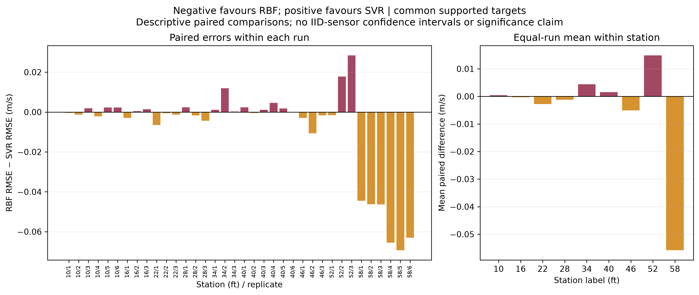

# Jet Bridge CFD, Interpolation and Machine Learning

An MMA3001 investigation of how accurately interpolation and support vector regression reconstruct sparse jet-bridge air-speed measurements, and what OpenFOAM virtual-sensor studies reveal about spatial sampling.

**Current status:** nested experimental comparisons, sensor-placement experiments and isothermal mesh/coordinate/flow checks have run. The buoyant thermal case remains unconverged. Numerical convergence is not experimental validation.

## Results you can inspect immediately

The [results gallery](docs/results/current/README.md) contains selected derived figures and small tables committed with the code. No OpenFOAM installation or local dataset is needed to read it. See the [run summary](docs/results/current/SUMMARY.md) and [methods/reproduction guide](docs/project_improvements.md).

For 36 experimental runs and 504 held-out sensor means, common supported locations give:

| Method | Mean per-run RMSE (m/s) |
| --- | ---: |
| Retained-sensor mean | 0.067648 |
| Nearest neighbour | 0.071293 |
| Linear interpolation | 0.055241 |
| Thin-plate RBF | 0.049590 |
| RBF-kernel SVR | 0.057741 |

Each experimental replicate is fitted separately. SVR hyperparameters are selected inside each outer training fold. Linear interpolation does not extrapolate; coverage and outside-hull errors are reported separately.



RBF wins 21 of 36 paired runs, but its mean advantage is concentrated at the 58 ft, 24-sensor layout. The 12-sensor runs slightly favour SVR on average. Station and layout density are confounded, so this is not evidence that density alone causes the difference. No IID-sensor significance claim is made.

The CFD checks quantify mesh sensitivity and small coordinate-rounding effects. A fixed 24-sensor hybrid layout also improves RBF/SVR full-section reconstruction in a synthetic 80%-flow case. These are numerical studies, not independently matched experimental validations.

## One-clone demonstration

The study inputs and compact CFD evidence are now included under `data/demo`, with hashes and [CC BY 4.0 dataset attribution](data/demo/ATTRIBUTION.md). No LFS pull or manual dataset copying is needed for the maintained figure collection. Install the existing OpenCFD v2412 runtime for live CFD, then run inside Ubuntu/WSL:

```bash
python3.12 -m venv .venv
source .venv/bin/activate
python -m pip install -r requirements-benchmark.txt
python -m pip install --no-deps -e .
python run_all.py --profile live --output ~/jetbridge-demo/live-01
```

Open the generated `index.html`. The output directory must be new. `live` runs a fresh baseline CFD solution; `full` also solves coarse/fine/80%-flow cases; `replay` redraws archived numerical evidence without running CFD. Thermal diagnostics remain archived and unconverged in all profiles. The [live-demo guide](docs/LIVE_DEMO.md) explains every stage, provenance, logs, runtime and the difference between fresh and archived data.

```bash
python run_all.py --profile full --output ~/jetbridge-demo/full-01
python run_all.py --profile replay --output ~/jetbridge-demo/replay-01
python run_all.py --profile full --plan
```

## Lint tests and API documentation

Ruff provides the requested Pylint-style static correctness gate; it is separate from numerical tests and physical CFD validation.

```bash
python -m ruff check src tests run_all.py
python -m pytest -q
python -m pdoc jetbridge_ml -o docs/html
```

See [development guidance](docs/DEVELOPMENT.md) for the selected rules, broader optional audit and JUnit report. CI applies the same lint command and tests Python 3.10 and 3.12. Earlier module-specific commands remain available through [research reproduction notes](docs/project_improvements.md), but the bundled driver is the current presentation entry point.
## OpenFOAM cases

The isothermal starter is [cfd/cases/empty_bridge_s01_a_10_hn_1](cfd/cases/empty_bridge_s01_a_10_hn_1/README.md). It uses steady incompressible k-epsilon RANS, a full-face supply and sealed walls. The tested v2412 writeFields compatibility entries are included. Run cases in a separate Linux/WSL directory and retain their logs and fields outside Git.

```bash
source /usr/lib/openfoam/openfoam2412/etc/bashrc
# In a separate copy of the case:
blockMesh > log.blockMesh
checkMesh > log.checkMesh
simpleFoam > log.simpleFoam
```

The [verification workflow](docs/project_improvements.md) prepares isolated coarse/fine meshes and a reduced-flow case, with bounded iteration caps. Three meshes provide sensitivity evidence; they do not automatically establish mesh independence or a GCI. The known 0.127 mm source-ceiling discrepancy remains documented.

The [thermal extension](docs/thermal_case_results.md) uses a cold supply and laboratory-temperature walls as an unmeasured wall-temperature surrogate. Its continuation still fails residual and stationarity checks. Thermal fields are excluded from ML/reference training.

## Project structure and evidence

| Location | Responsibility |
| --- | --- |
| src/jetbridge_ml/data_processing | Experimental readers, units and source records |
| src/jetbridge_ml/interpolation | Traditional reconstruction methods |
| src/jetbridge_ml/machine_learning | SVR fitting and training-only selection |
| src/jetbridge_ml/cfd_interface | CFD sampling, numerical checks and comparisons |
| src/jetbridge_ml/validation | Error metrics, spatial splits and reduced stability checks |
| cfd/cases | OpenFOAM inputs and reproducible case preparation |
| tests | Numerical and data-handling checks |
| docs/results/current | Selected reproducible figures and small derived summaries |
| data/processed | Ignored complete local outputs |

The [.github workflow](.github/workflows/numerical-checks.yml) installs the Python package and runs tests without external measurements or OpenFOAM, then saves JUnit results. It runs on pushes and pull requests; see the [check history](https://github.com/matt-b-0/jetbridge-ml-cfd/actions).

Background and research assumptions: [PROJECT_CONTEXT.md](PROJECT_CONTEXT.md), [assumptions](docs/assumptions.md), [four-workstream results](docs/four_workstreams_results.md), [numerical stability](docs/numerical_stability_study.md), and [AI-use record](docs/ai_usage_log.md).

Selected FAA/NRC records and compact numerical inputs are included under data/demo. Duplicate/full raw time-series archives, generated meshes, saved fields and fitted model binaries remain outside Git. The public repository includes source, tests, documentation and selected derived results. Dataset provenance and source details are recorded in PROJECT_CONTEXT.md and the analysis manifests.
Nine [additional report figures with PNG/PDF downloads and captions](docs/results/additional_figures/README.md) show model skill, station/layout effects, mesh profiles, flow-transfer error maps and unresolved thermal convergence.

The [revised report and controlled performance workflow](docs/report/README.md) documents error interpretation, sensor coverage, scaled noise sensitivity and reproducible timing; the thermal fields remain diagnostic and unconverged.

[Second report review evidence and submission audit](docs/report/SECOND_REVIEW_AUDIT.md) includes spatial reconstructions, physical hull coverage, selection/sensitivity diagnostics and the current reproducibility gaps. Generated [HTML API documentation](docs/html/index.html) and the [local test report](docs/report/test-results.xml) are included.

The [final report review and representative reproduction commands](docs/report/FINAL_REVIEW_AUDIT.md) add explicit physical coverage, the decisive 58 ft example and an exploratory lower-C check. The licence remains undecided; the final-review audit separates implementation, document packaging and publication revisions.


[Demo verification](docs/demo_validation/README.md): 82 tests and Ruff pass; fresh public-clone live/replay workflows pass. Measured stage times were about 4.8 minutes for live, 3.5 for replay and 12.9 for full, excluding initial hashing. Live/full produce 80 PNG output files; thermal diagnostics remain explicitly archived and unconverged.
