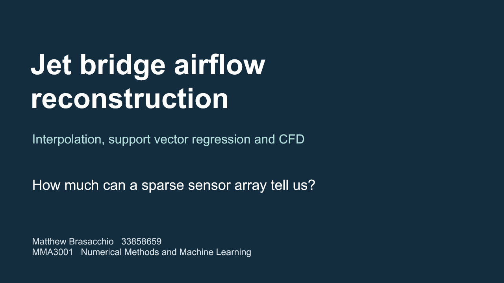
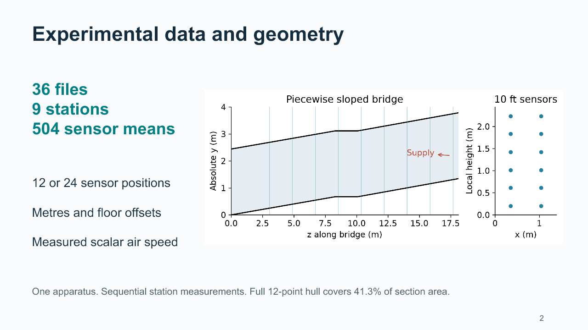
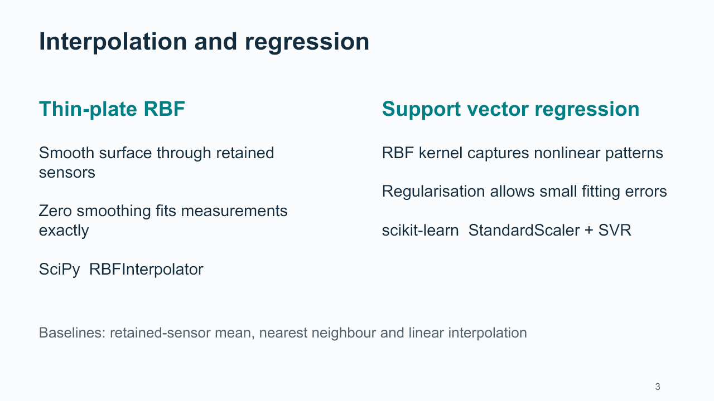
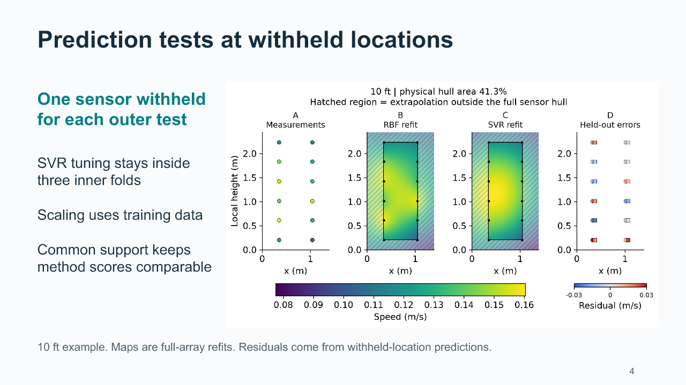
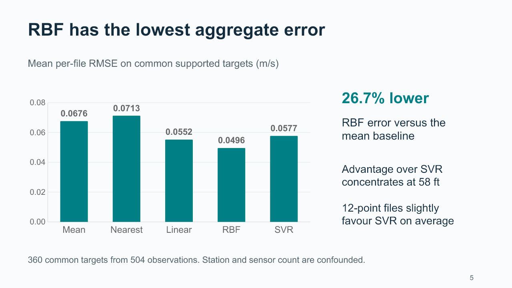
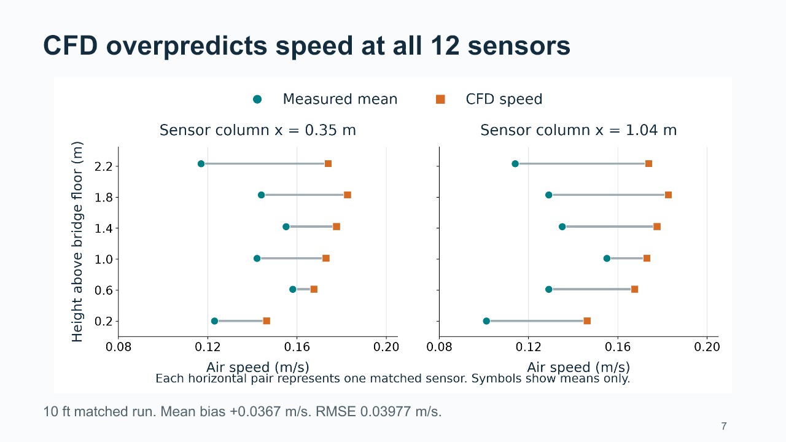
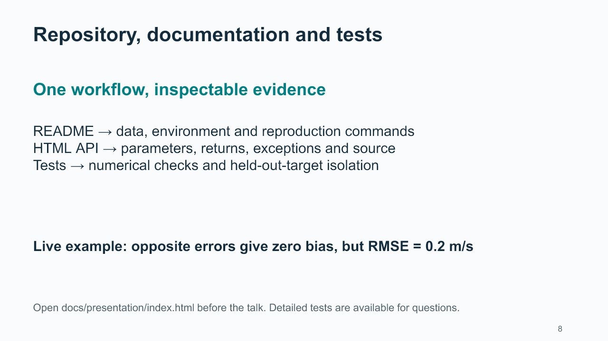
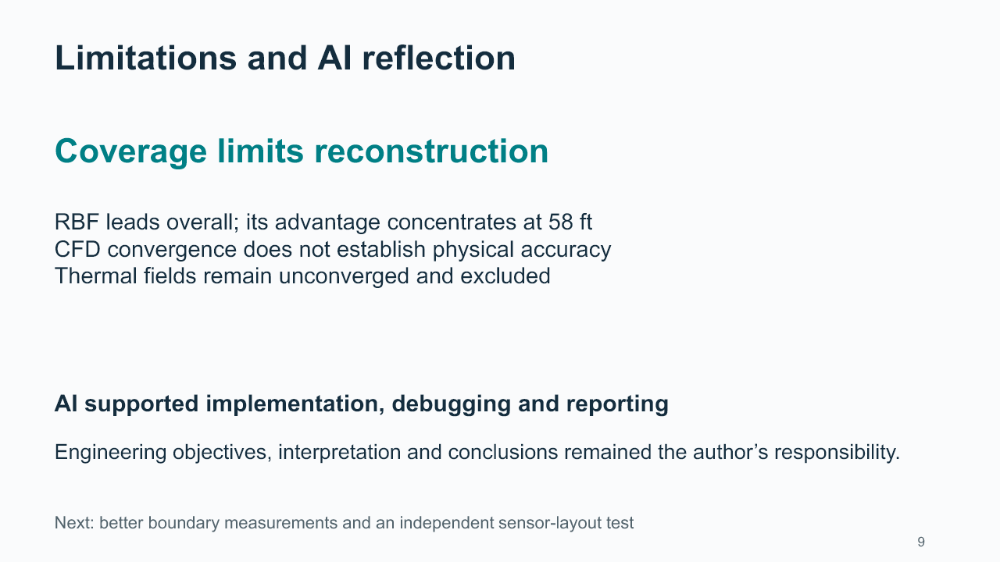

# Presentation materials

Use this page as the entry point during the presentation. It is readable directly on GitHub.

- [Download the PowerPoint](Jet_Bridge_Presentation.pptx?raw=true) — nine main slides with timed speaker notes, followed by eleven backup slides.
- [Five-minute tutorial and questions](PRESENTATION_TUTORIAL.md).
- [Tests explained line by line](TEST_WALKTHROUGH.md).
- [Speaker notes extracted from the deck](SPEAKER_NOTES.md).
- [Actual demonstration test source](../../tests/test_presentation_examples.py).
- [Actual SVR leakage/scaling test source](../../tests/test_four_workstreams.py).
- [Repository setup and reproduction](../../README.md).

Fresh scientific-worker checks on 11 November: **128 passed, 1 skipped**; Ruff passed. The native Tk layout module was skipped in WSL. Earlier native GUI evidence remains separately dated. Scientific results are unchanged.

## HTML pages

GitHub's file viewer displays HTML source rather than running the page. To use the interactive tutorial, API documentation and readable test report, choose **Code → Download ZIP**, extract it, and open `docs/presentation/index.html`. All required pages are included and work offline. No Python or OpenFOAM installation is needed to read them. Running the numerical workflows requires the documented environment.

The local tutorial links the complete test source catalogue and current API. Two Tk-only module references are explicitly generated from source; they are not evidence of successful native execution.

## Main slides — browser fallback

Use these images if PowerPoint is unavailable. Each image is rendered from the packaged deck; editable slides and notes remain in the PPTX.

### 1. Jet bridge airflow

### 2. Experimental data and geometry

### 3. Interpolation and regression

### 4. Prediction tests at withheld locations

### 5. RBF has the lowest aggregate error

### 6. CFD setup and initial conditions

### 7. CFD overpredicts speed at all 12 sensors

### 8. Repository, documentation and tests

### 9. Limitations and AI reflection

## Backup slides

- [10. Backup  Libraries and their roles](slides/slide-10.png)
- [11. Backup  Reconstructing a CFD field](slides/slide-11.png)
- [12. Backup  Numerical stability and accuracy](slides/slide-12.png)
- [13. Backup  Sources and scope](slides/slide-13.png)
- [14. Alternative B  Size of the CFD overprediction](slides/slide-14.png)
- [15. Alternative C  Height profiles and temporal variation](slides/slide-15.png)
- [16. Alternative D  A simpler parity comparison](slides/slide-16.png)
- [17. Backup  Rubric evidence](slides/slide-17.png)
- [18. Backup  A test with a known answer](slides/slide-18.png)
- [19. Backup  Preventing test-data leakage](slides/slide-19.png)
- [20. Backup  Accuracy, robustness and computational cost](slides/slide-20.png)
