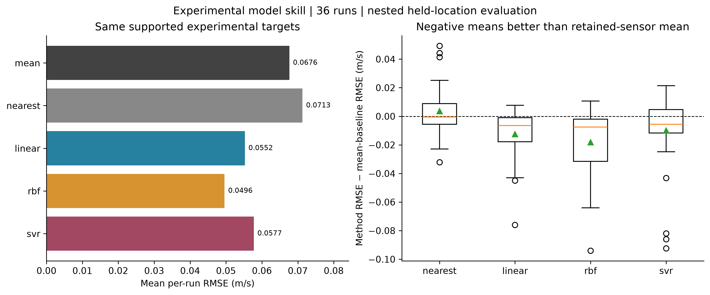
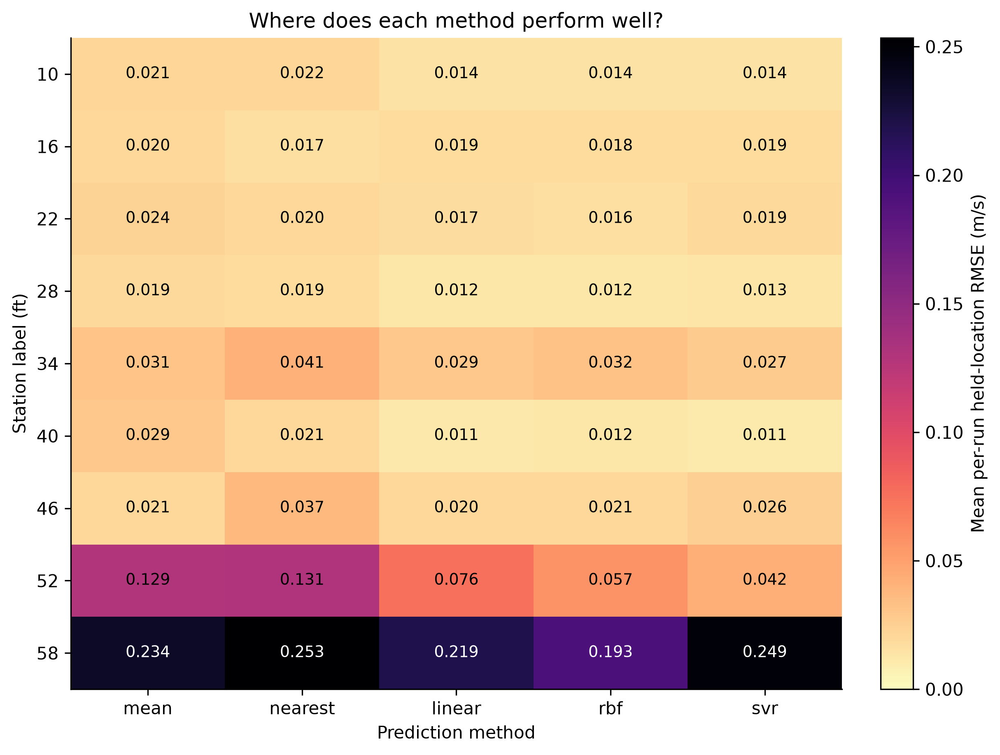
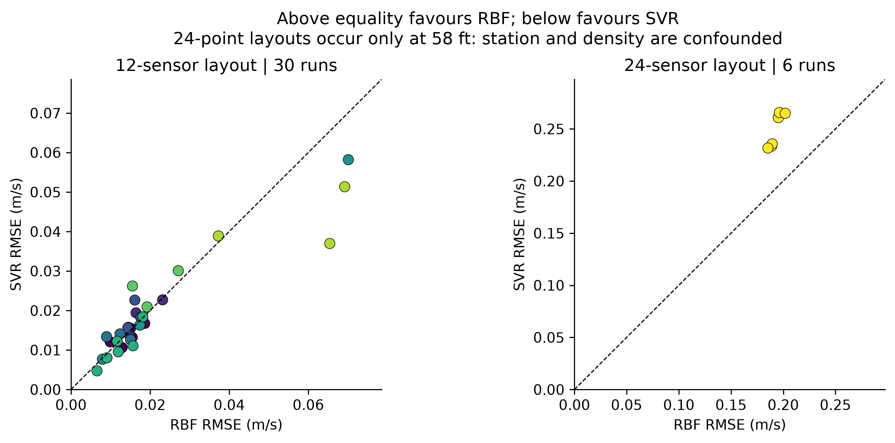
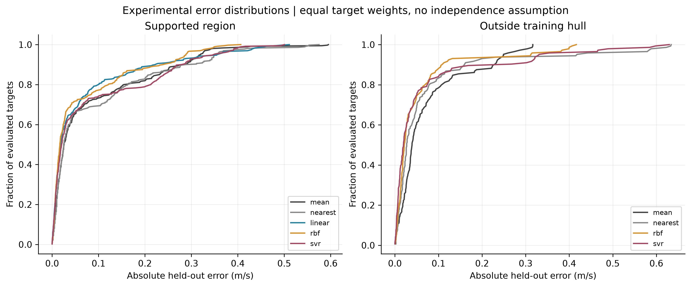
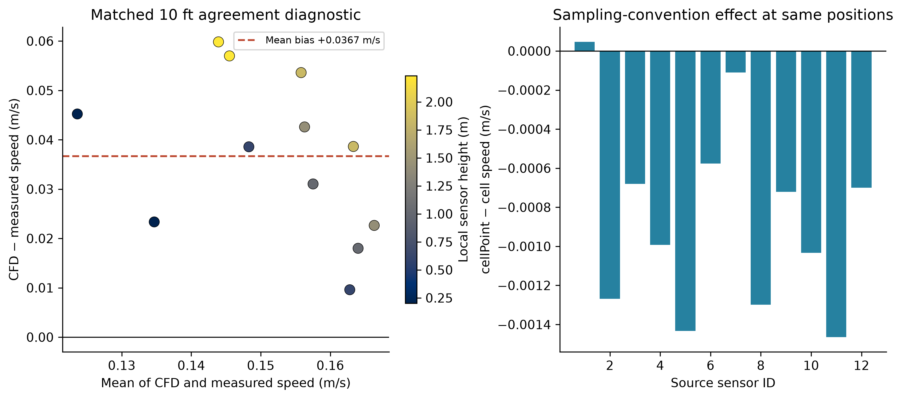
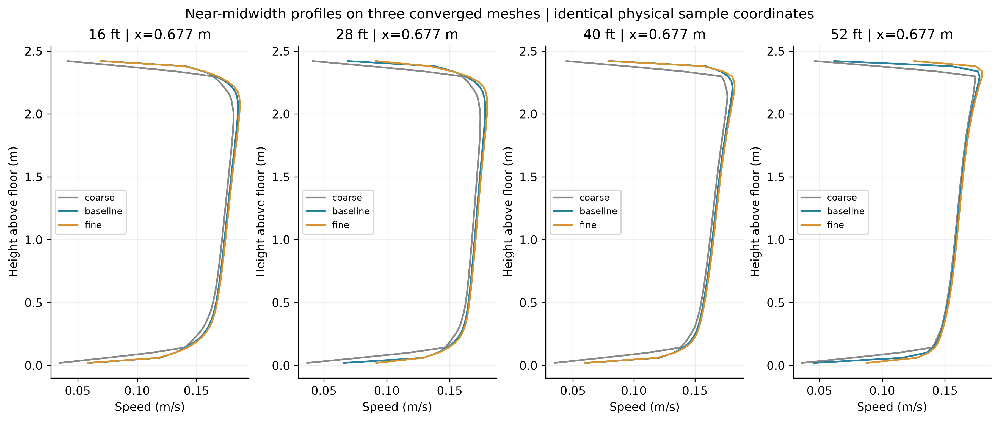
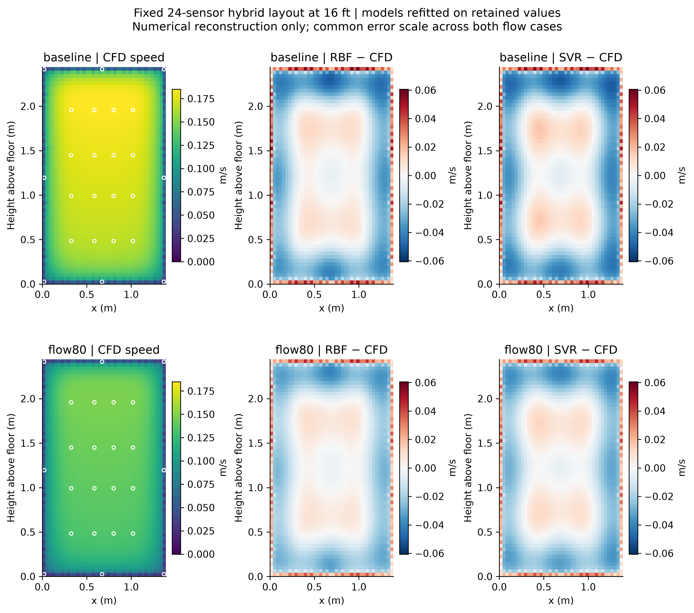
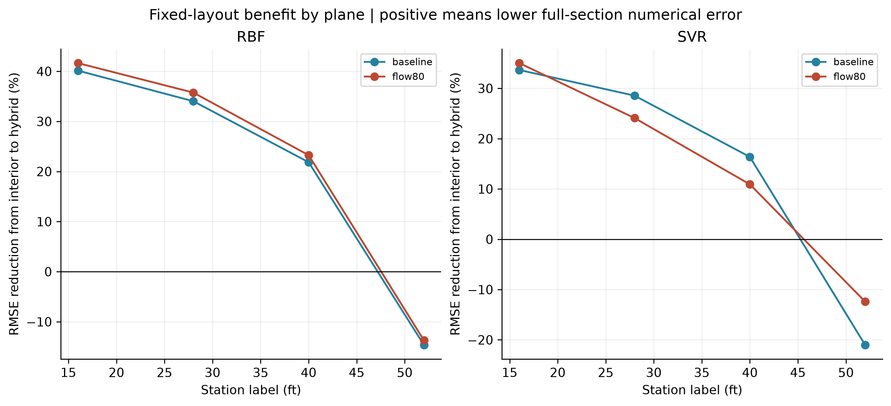
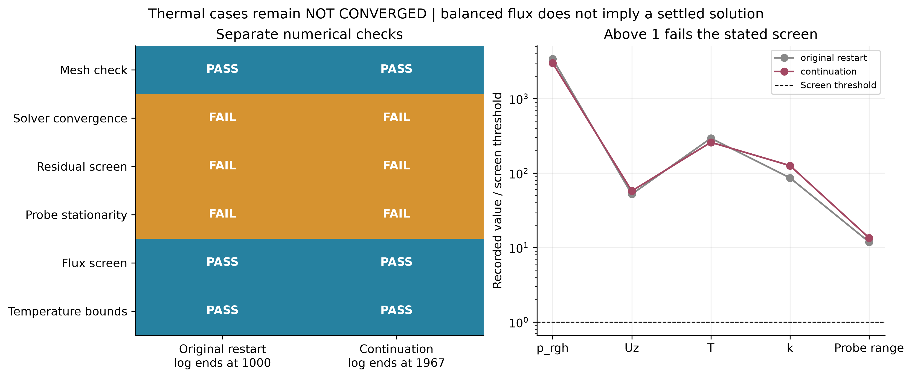

# Additional report figures

Nine PNG/PDF figures. Use PDF for report linework and PNG for slides. Error plots retain their reference-data and coverage distinctions.

## 01_model_skill

Left: equal-run mean RMSE at common supported locations. Right: descriptive distribution of paired run differences against the training-only mean baseline; boxplots are not confidence intervals. Runs share one apparatus.



[PDF](01_model_skill.pdf)

## 02_station_error_heatmap

Errors averaged within station and replicate before station aggregation, on common supported targets. Different stations have different operating conditions; the heatmap is not a matched multi-station CFD validation.



[PDF](02_station_error_heatmap.pdf)

## 03_layout_stratified_comparison

Paired model errors split by source layout size. These groups were inspected after evaluation and are descriptive. Their differences cannot identify a causal effect of sensor count; all 24-point layouts are at the inlet station.



[PDF](03_layout_stratified_comparison.pdf)

## 04_experimental_error_distributions

Empirical target-error distributions, separate from the equal-run RMSE ranking. Dense-layout runs receive more target weight here. Linear has no outside-hull predictions; curves do not represent uncertainty or confidence intervals.



[PDF](04_experimental_error_distributions.pdf)

## 05_matched_agreement

Only the matched isothermal 10 ft run is shown. CFD error is plotted against paired mean speed, with no normal-theory limits of agreement because the 12 spatial samples do not justify that assumption. Sampling differences are not experimental discrepancies.



[PDF](05_matched_agreement.pdf)

## 06_mesh_height_profiles

Vertical profiles at the same near-midwidth x coordinate on three meshes. The fine solution is not exact truth; differences quantify numerical sensitivity, not experimental validation or demonstrated mesh independence.



[PDF](06_mesh_height_profiles.pdf)

## 07_flow_transfer_error_maps

CFD speed and reconstruction differences on the 16 ft plane at baseline and synthetic 80% flow. White circles mark retained virtual sensors. SVR selection uses only retained values. This tests fixed-layout transfer with refitted models, not a frozen surrogate or experimental validation.



[PDF](07_flow_transfer_error_maps.pdf)

## 08_layout_transfer_gain

Relative reductions compare the same number of sensors and same evaluation grid within each flow/plane. Results are limited to one geometry, one turbulence model and a controlled 80% flow perturbation; not broad physical generalisation.



[PDF](08_layout_transfer_gain.pdf)

## 09_thermal_numerical_screens

Numerical screens at the ends of the two logs. Original log ends at 1000 but its latest saved field is 967; continuation ends and saves at 1967. Temperature range uses each log-end 100-iteration probe window. Threshold-normalised quantities are diagnostic ratios, not uncertainties or physical validation metrics.



[PDF](09_thermal_numerical_screens.pdf)


## Reproduce these figures

```bash
python -m jetbridge_ml.report_synthesis \
  --analysis /path/to/completed-submission-analysis \
  --verification-samples /path/to/completed-isothermal-verification \
  --output /path/to/new-report-figures
```

The analysis tables come from run_analysis; verification samples come from verification_study. This command does not run CFD. Figure 07 refits the same predefined CFD reconstruction methods with training-only selection. For figure 01, boxes show the interquartile range, the horizontal line is the median, the triangle is the mean, and whiskers use the standard 1.5-IQR rule. These are descriptive run distributions, not confidence intervals.

Current execution entry point: run_all.py at the repository root. The guide docs/LIVE_DEMO.md covers included data and fresh versus archived results; docs/DEVELOPMENT.md documents Ruff linting, pytest and pdoc. These current instructions supplement the dated research results above.
