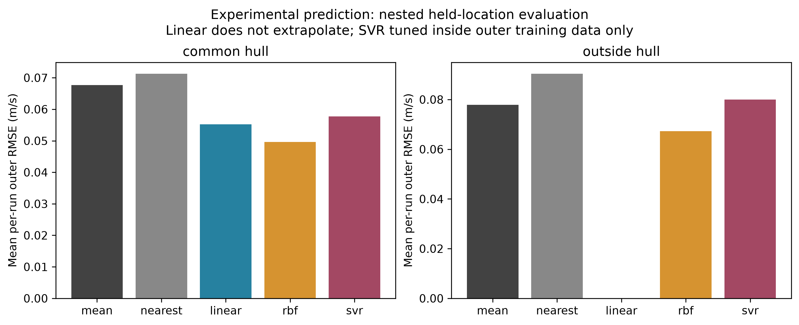
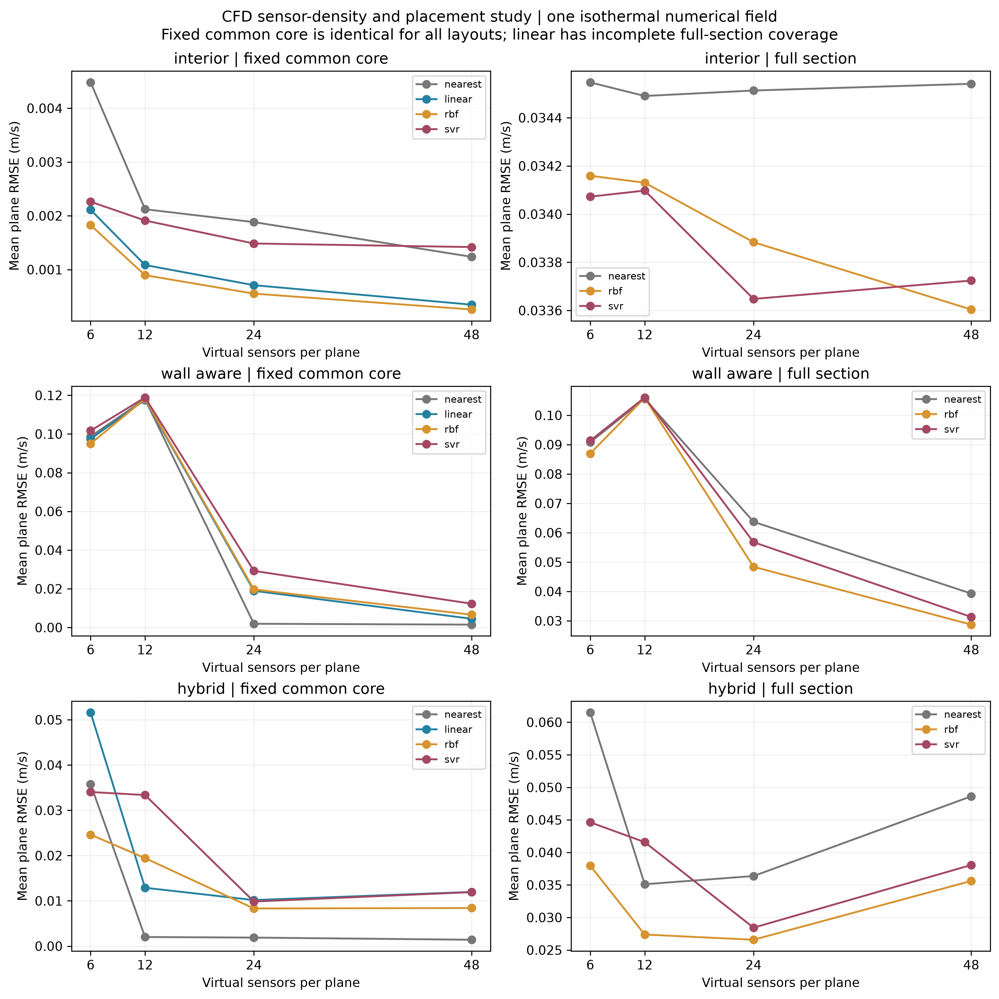
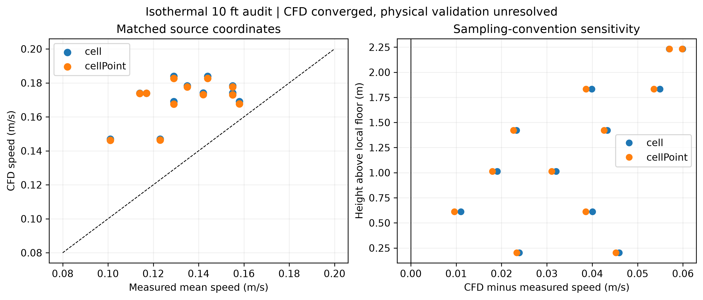
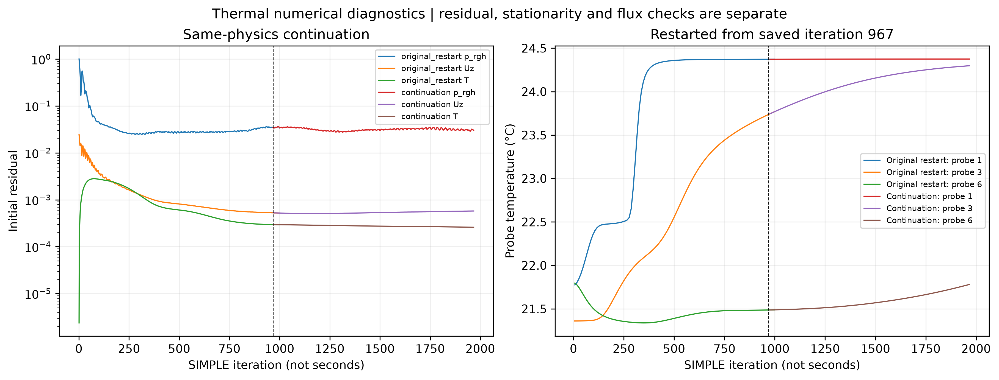
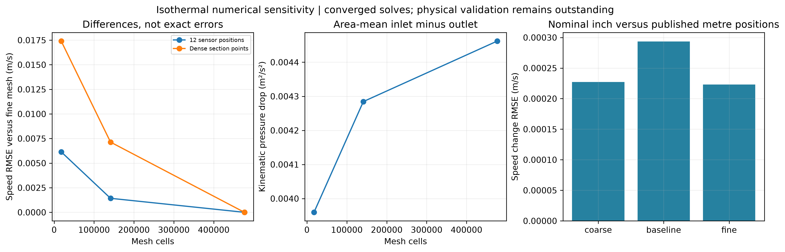
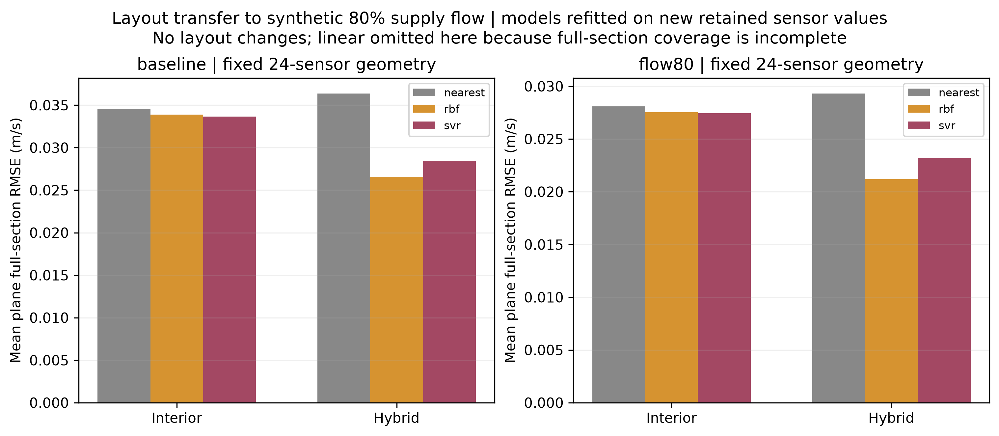

# Reproducible analysis gallery

Derived plots and small summary tables only. Experimental prediction, CFD reconstruction and thermal diagnostics remain distinct.

## Experimental

[summary.csv](experimental/summary.csv)

## Paired

[paired_runs.csv](paired/paired_runs.csv)

[paired_stations.csv](paired/paired_stations.csv)

[paired_layouts.csv](paired/paired_layouts.csv)

[versus_mean.csv](paired/versus_mean.csv)

[summary.json](paired/summary.json)

## Sensor Design

[summary.csv](sensor_design/summary.csv)

## Matched

[audit.json](matched/audit.json)

## Thermal

[audit.json](thermal/audit.json)

## Verification

[mesh_metrics.csv](verification/mesh_metrics.csv)

[coordinate_metrics.csv](verification/coordinate_metrics.csv)

[transfer_metrics.csv](verification/transfer_metrics.csv)

[summary.json](verification/summary.json)

[Run summary](SUMMARY.md)

Thermal results remain unconverged; no experimental validation is claimed. Mesh checks assess sensitivity, not automatic mesh independence.
